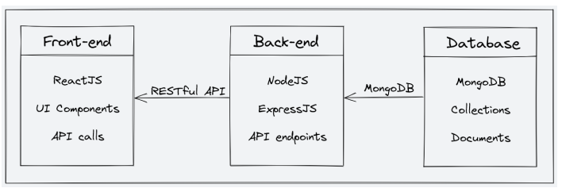
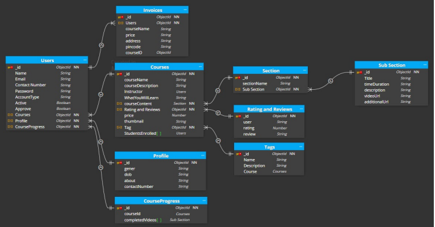

# StudyNotion

StudyNotion is an ed-tech app where students browse and take courses, and instructors build courses, upload lectures, and see how those courses are doing. The site is React. The API is Express. Data lives in MongoDB.


This repository is the full project from `StudyNotion.zip`: frontend, API, assets, and local env files. `node_modules` is not included. Install dependencies on the machine where you run it.

## Features

**Students**

- Create an account as a student or an instructor
- Log in, reset a password, and update profile details
- Browse the catalog and open a course
- Add courses to the cart and go through checkout
- Watch enrolled lectures and mark progress
- Rate a course

**Instructors**

- Dashboard with course stats
- Create a course in steps: details, curriculum, publish
- Add sections and video lectures
- Edit or delete a course

**Platform**

- JWT login and route protection
- Email OTP on signup. Without SMTP, the code is shown in the app and printed by the API
- Cloudinary for images and video when those keys are set
- Razorpay checkout when those keys are set

## Tech stack

| Layer | Tools |
| --- | --- |
| UI | React 18, React Router, Redux Toolkit, Tailwind CSS |
| API | Node.js, Express, JWT, bcrypt |
| Data | MongoDB, Mongoose |
| Media | Cloudinary |
| Payments | Razorpay |
| Mail | Nodemailer |

## Run it

You need Node.js 18 or newer and MongoDB listening on `mongodb://127.0.0.1:27017`.

```bash
npm run install-all
npm run dev
```

- Site: http://localhost:3000
- API: http://localhost:4000

The API root returns `{ "success": true, "message": "Your server is up and running...." }`.

Signup does not need a real inbox. Submit the form, then enter the 6-digit code from the toast or the API terminal.

## Configuration

Root `.env` (already filled for a laptop):

```bash
REACT_APP_BASE_URL=http://localhost:4000/api/v1
```

`server/.env`:

| Variable | Required to boot | Purpose |
| --- | --- | --- |
| `PORT` | No, defaults to 4000 | API port |
| `MONGODB_URL` | Yes | Mongo connection string |
| `JWT_SECRET` | Yes | Signs login tokens. Change this before any shared deployment |
| `FRONTEND_URL` | No, defaults to `http://localhost:3000` | Browser origin allowed by CORS |
| `MAIL_HOST`, `MAIL_USER`, `MAIL_PASS` | No | SMTP. Signup still works without them |
| `CLOUD_NAME`, `API_KEY`, `API_SECRET`, `FOLDER_NAME` | No | Course and profile media |
| `RAZORPAY_KEY`, `RAZORPAY_SECRET` | No | Paid checkout |

Change `JWT_SECRET` if anyone other than you can reach the API. The value in the repo is only a local default.

## Project layout

```text
src/                 React app: pages, dashboard, catalog, auth
public/              HTML shell
server/index.js      Express entry
server/routes/       /api/v1/auth, profile, course, payment, reach
server/controllers/  Request handlers
server/models/       Mongoose models
server/mail/         Email HTML
images/              README figures
```

## API

| Prefix | What it covers |
| --- | --- |
| `/api/v1/auth` | OTP, signup, login, password changes |
| `/api/v1/profile` | Profile, display picture, enrolled courses, instructor stats |
| `/api/v1/course` | Categories, course CRUD, sections, lectures, reviews, progress |
| `/api/v1/payment` | Razorpay order and verification |
| `/api/v1/reach` | Contact form |

## Scripts

| Command | What it does |
| --- | --- |
| `npm run install-all` | Installs the React app and the API |
| `npm start` | React dev server only |
| `npm run server` | API only, from `server/` |
| `npm run dev` | Site and API together |
| `npm run build` | Production React build |

## Where this code came from

The application is the public StudyNotion project at [saumyatiwaryy/Study-Notion](https://github.com/saumyatiwaryy/Study-Notion). This copy is packaged so it runs from the downloaded zip: local API URL, CORS for localhost, Tailwind wired up, and signup that still works when email is not configured.




